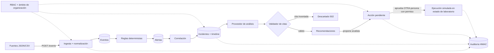

# AegisTrace

Plataforma de investigación y respuesta asistida para incidentes de seguridad. Convierte eventos dispersos en incidentes priorizados, investigables y auditables. El análisis asistido explica la evidencia y sugiere acciones; **las respuestas sensibles requieren permisos y aprobación humana**.

> **Estado:** MVP funcional de la API (fases 1–4 del plan) con datos sintéticos. Ver [Alcance y limitaciones](#alcance-y-limitaciones) antes de usarlo en serio.

## Qué hace hoy

| Capacidad | Implementación |
|---|---|
| Ingesta y normalización | `POST /api/v1/events` acepta objeto, array, `{events:[]}` o `text/csv`. Alias de campos, fecha → UTC ISO, IP validada, tipos canónicos, control chars eliminados, límites de tamaño. Idempotente por ID (o hash del contenido). |
| Detección por reglas | R001 fallos de login en ráfaga · R002 login exitoso tras fallos (crítica) · R003 password spraying · R010 errores de autorización · R020 cambio de permisos (admin / auto-concesión). Función pura y determinista. |
| Correlación | Alertas → incidentes por usuario/IP compartidos en ventana de 30 min; cada incidente guarda `linkReasons` con el porqué. |
| Investigación asistida | `POST /incidents/{id}/analysis`: resumen, hipótesis con confianza, alternativas benignas, recomendaciones y **lagunas de datos**. Cada cita se valida contra los eventos del incidente; si no, se descarta (502). |
| Gestión de incidentes | Estados con transiciones válidas, responsable, etiquetas, comentarios, línea de tiempo, filtros, búsqueda y paginación. |
| Respuesta controlada | Solo **simuladas** (`block_ip`, `disable_user`), limitadas a un ámbito de laboratorio (`192.0.2/24`, `198.51.100/24`, `203.0.113/24`, `10/8`, usuarios `lab.*`). Propuesta → aprobación por otra persona → ejecución simulada. |
| Auditoría | Cadena HMAC por organización: consultas, denegaciones, aprobaciones y ejecuciones. `GET /audit/verify` detecta ediciones y borrados. |
| Panel | `GET /dashboard` + UI estática en `/ui/`: alertas por severidad, incidentes abiertos, mediana de triage, tasa de falsos positivos. |
| Operación | Logs JSON estructurados, `/health`, `/metrics` (contadores), rate limiting por clave. |

## Arquitectura



Capas: `api/src` — `normalize` → `rules` → `pipeline` (alertas + correlación) → `analysis` → `app` (HTTP, RBAC, auditoría). `store` es el único acceso a datos y siempre exige `orgId`.

## Puesta en marcha

```bash
cd api && npm ci
npm test              # 48 pruebas: unitarias, integración, aislamiento, auditoría, E2E
npm run eval          # precisión/recall sobre el dataset sintético etiquetado
npm run dev           # http://localhost:3000  (UI en /ui/)
# o: docker compose up --build
./scripts/demo.sh     # flujo completo contra la API en marcha (BASE=http://localhost:3000)
```

Claves de demostración (solo con `NODE_ENV != production`): `demo-viewer`, `demo-ingestor`, `demo-analyst`, `demo-approver`, `demo-auditor`, `demo-admin` (org `org-acme`) y `demo-other-admin` (org `org-globex`), enviadas en la cabecera `x-api-key`. En producción hay que definir `AEGIS_API_KEYS` y `AEGIS_AUDIT_KEY`; si faltan, el servidor no arranca.

### Roles

| Rol | Permisos |
|---|---|
| viewer | lectura |
| ingestor | solo ingesta |
| analyst | lectura + ingesta + gestionar incidentes + pedir análisis + **proponer** acciones |
| approver | analyst + **aprobar/rechazar** (no puede aprobar lo que él mismo propuso) |
| auditor | lectura + auditoría |
| admin | todo |

### API

`POST /api/v1/events` · `GET /events` · `GET /alerts` · `GET /incidents` · `GET /incidents/{id}` · `POST /incidents/{id}/{status|comments|labels|assignee|analysis|actions}` · `GET /actions` · `POST /actions/{id}/{approve|reject}` · `GET /lab-state` · `GET /audit` · `GET /audit/verify` · `GET /dashboard`.

## Seguridad: qué está cubierto y cómo se prueba

- **Permisos en servidor** en cada ruta; las denegaciones se auditan (`test/api.test.ts › RBAC`).
- **Aislamiento entre organizaciones**: el `orgId` sale de la credencial, nunca del cliente; ver IDs ajenos da 404 (`› organization isolation`).
- **IA separada de la ejecución**: el análisis solo escribe recomendaciones; no existe ruta que ejecute una acción sin `actions:approve` y sin ser otra persona (`› controlled response`).
- **Logs = datos no confiables**: el proveedor determinista solo lee campos estructurados, nunca el texto libre; hay prueba con un mensaje con instrucciones inyectadas (`› treats log content as data`). Un proveedor LLM futuro pasaría por el mismo validador de citas.
- **Entradas**: validación con zod/normalizador, límites (512 KB JSON, 1 MB CSV, 1000 eventos por lote), rate limiting.
- **Secretos**: sin claves en código para producción; el servidor se niega a arrancar con credenciales demo.
- **Datos**: solo sintéticos (`data/synthetic`, regenerables con `npm run dataset`).

## Evaluación

`npm run eval` ejecuta las reglas sobre 248 eventos / 81 escenarios etiquetados (17 maliciosos, 64 benignos con casi-aciertos: 2–4 fallos, fallos lentos, denegaciones sueltas, cambios de rol rutinarios) y mide alertas ≥ medium: **precisión 1.00, recall 1.00, 0 escenarios benignos alertados**.

**Lee esto con cautela:** el dataset lo escribí yo junto con las reglas, así que los umbrales encajan con él por construcción. Sirve como prueba de regresión y de reproducibilidad, **no** como estimación de rendimiento real. Un dataset independiente o logs reales anonimizados darían cifras más honestas.

## Alcance y limitaciones

Implementado: ingesta, reglas, correlación, análisis con citas, incidentes, acciones simuladas con aprobación, auditoría, panel mínimo, Docker, CI.

**No implementado** (diferencias con la propuesta original):
- **PostgreSQL / Redis**: el MVP usa un almacén en memoria (se pierde al reiniciar). El esquema objetivo está en [`db/schema.sql`](db/schema.sql), sin conectar. Ver [ADR 0002](docs/adr/0002-in-memory-store-for-mvp.md).
- **Servicio FastAPI** de anomalías: no existe.
- **Frontend React**: solo una página estática de solo lectura.
- **Proveedor LLM**: el análisis es determinista (`rule-based-v1`); la interfaz `AnalysisProvider` está lista para enchufar uno.
- **Autenticación**: claves API estáticas; sin usuarios, sesiones ni SSO. Sin retención/borrado de logs automático.
- **Auditoría**: la cadena no detecta el truncado del final del log a menos que se ancle `head`/`entries` fuera del sistema (soportado vía `?anchorHead=&anchorEntries=`, ver ADR 0004).
- **Detección**: se reevalúa sobre todos los eventos de la organización en cada ingesta (O(n)); válido para laboratorio, no para alto volumen. Sin trazas distribuidas; las métricas son contadores simples.
- **Entregables de publicación** pendientes: capturas, vídeo de 2–3 min.
- No se ha ejecutado `docker build` en este entorno de desarrollo; el CI lo hace.

## Documentación

[ADR 0001 – Reglas deterministas primero](docs/adr/0001-deterministic-rules-first.md) · [0002 – Almacén en memoria](docs/adr/0002-in-memory-store-for-mvp.md) · [0003 – IA solo recomienda](docs/adr/0003-ai-recommends-humans-approve.md) · [0004 – Auditoría encadenada](docs/adr/0004-hash-chained-audit.md)
