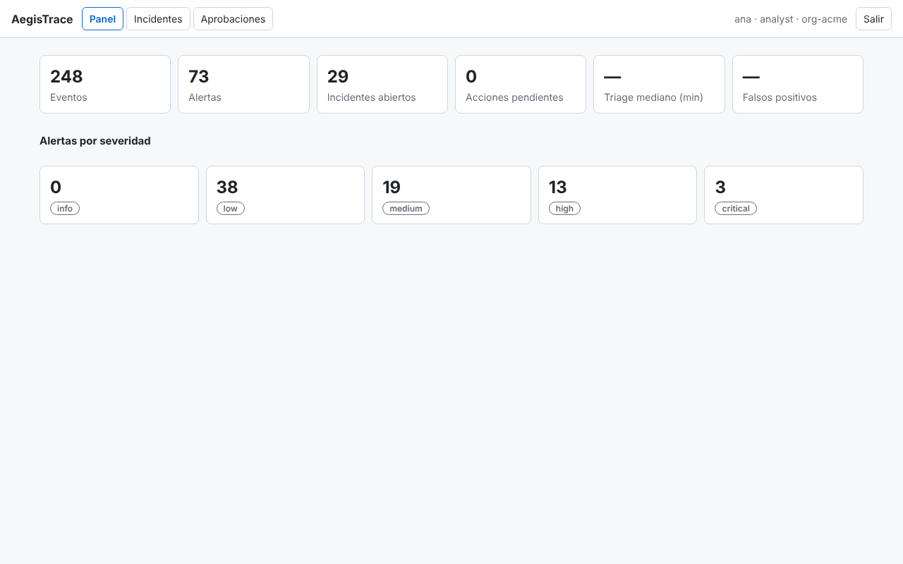
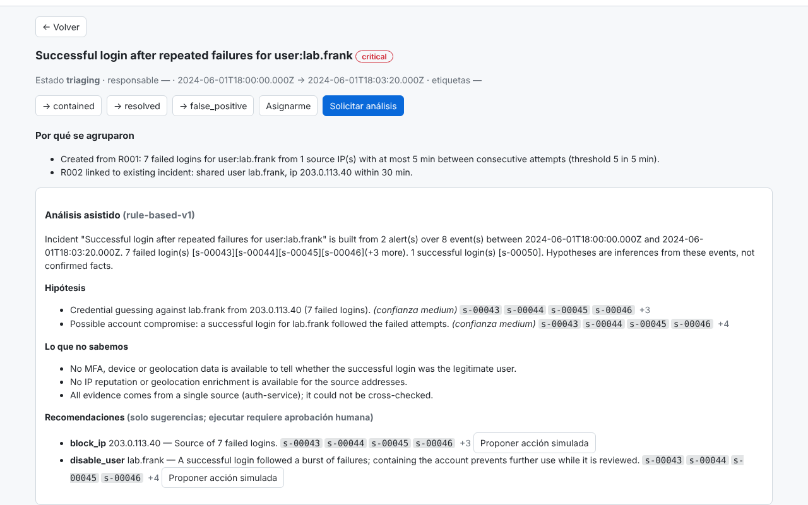
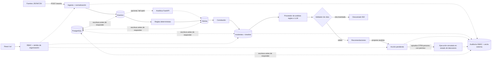

# AegisTrace

Plataforma de investigación y respuesta asistida para incidentes de seguridad. Convierte eventos dispersos en incidentes priorizados, investigables y auditables. El análisis asistido explica la evidencia y sugiere acciones; **las respuestas sensibles requieren permisos y aprobación humana**.

> **Estado:** MVP funcional con datos sintéticos: API, PostgreSQL, servicio de anomalías, interfaz React y análisis opcional con LLM. Ver [Alcance y limitaciones](#alcance-y-limitaciones) antes de usarlo en serio.




Vídeo del flujo completo (analista → aprobador → auditor): [`docs/media/demo.webm`](docs/media/demo.webm) · más capturas en [`docs/media/`](docs/media/).

## Qué hace hoy

| Capacidad | Implementación |
|---|---|
| Ingesta y normalización | `POST /api/v1/events` acepta objeto, array, `{events:[]}` o `text/csv`. Alias de campos, fecha → UTC ISO, IP validada, tipos canónicos, control chars eliminados, límites de tamaño. Idempotente por ID (o hash del contenido). |
| Detección por reglas | R001 fallos de login en ráfaga · R002 login exitoso tras fallos (crítica) · R003 password spraying · **R004 fallos lentos y sostenidos** · **R005 credential stuffing** · R010 errores de autorización · R020 cambio de permisos (roles privilegiados por patrón, auto-concesión). Función pura y determinista; admite **contexto de la organización** (`AEGIS_SERVICE_ACCOUNTS`, `AEGIS_CHANGE_APPROVERS`) para bajar la severidad de cuentas de servicio y cambios aprobados. |
| Detección estadística | Servicio FastAPI (`analytics/`): picos de fallos por usuario (z-score robusto) y login desde IP nueva. Opcional (`ANALYTICS_URL`) y *fail-open*. Mide peor que las reglas, ver [Evaluación](#evaluación). |
| Correlación | Alertas → incidentes por usuario/IP compartidos en ventana de 30 min; cada incidente guarda `linkReasons` con el porqué. |
| Investigación asistida | `POST /incidents/{id}/analysis` con proveedor determinista o LLM (Anthropic u OpenAI, `AEGIS_ANALYSIS_PROVIDER=anthropic|openai`): resumen, hipótesis con confianza, alternativas benignas, recomendaciones y **lagunas de datos**. Cada cita se valida contra los eventos del incidente; si no, se descarta (502). |
| Gestión de incidentes | Estados con transiciones válidas, responsable, etiquetas, comentarios, línea de tiempo, filtros, búsqueda y paginación. |
| Respuesta controlada | Solo **simuladas** (`block_ip`, `disable_user`), limitadas a un ámbito de laboratorio (`192.0.2/24`, `198.51.100/24`, `203.0.113/24`, `10/8`, usuarios `lab.*`). Propuesta → aprobación por otra persona → ejecución simulada. |
| Autenticación | Contraseña (scrypt) + **MFA TOTP** opcional por usuario (RFC 6238, códigos de un solo uso) → token HMAC con caducidad; bloqueo tras 5 fallos; **SSO OIDC** (código + PKCE, `state`, `nonce`, `id_token` verificado con JWKS, grupos → roles); claves API para cuentas de servicio. Quitar un usuario local revoca sus sesiones. |
| Usuarios | Alta, rol, desactivación, reseteo de contraseña (temporal de un solo uso, cambio obligatorio) y de MFA por API/UI; cambio de contraseña propio; **MFA con códigos de recuperación**; semillas TOTP cifradas (AES-GCM). Cambiar contraseña o desactivar invalida las sesiones anteriores. |
| Retención | `AEGIS_RETENTION_DAYS`: borra eventos antiguos y incidentes cerrados (con sus alertas, análisis y acciones) de memoria y base de datos, conservando la evidencia de incidentes abiertos; simulación previa; programada y bajo demanda. La auditoría no se purga. |
| Operación | Cabeceras de seguridad (CSP, anti-frames, `no-store`, HSTS), `X-Request-Id`, `/health`, `/ready`, `/metrics` con histograma de latencia, apagado ordenado, `docker-compose.prod.yml` con TLS (Caddy), copia y restauración (`scripts/backup.sh`, `restore.sh`). |
| Persistencia | PostgreSQL con escritura antes de responder y recarga al arrancar (`DATABASE_URL`); sin ella, memoria. Eventos en inserción por lotes. |
| Límites compartidos | Rate limiting y bloqueo de login en memoria o en **Redis** (`REDIS_URL`), compartidos entre instancias. |
| Auditoría | Cadena HMAC por organización: consultas, denegaciones, logins, aprobaciones y ejecuciones. `GET /audit/verify` detecta ediciones y borrados; con ancla externa (`AEGIS_AUDIT_ANCHOR_FILE`) también el truncado del final. |
| Interfaz | React + TypeScript en `/ui/`: login (con código MFA y botón SSO), panel (alertas por severidad, incidentes abiertos, mediana de triage, falsos positivos), búsqueda y filtros, detalle con línea de tiempo y análisis, aprobaciones, auditoría. |
| Operación | Logs JSON estructurados, `/health`, `/metrics` (contadores), rate limiting por clave. |

## Arquitectura



Capas: `api/src` — `normalize` → `rules` (+ `analytics`) → `pipeline` (alertas + correlación) → `analysis`/`llm` → `app` (HTTP, auth, RBAC, auditoría) → `persistence`. `store` es el único acceso a datos y siempre exige `orgId`. `web/` es la interfaz, `analytics/` el servicio de anomalías, `api/migrations/` el esquema usado.

## Puesta en marcha

```bash
docker compose up --build            # API+UI en http://localhost:3000/ui/ , PostgreSQL, Redis, analítica
```

Sin Docker:

```bash
cd api && npm ci && npm run dev                              # API en :3000 (memoria; con DATABASE_URL usa PostgreSQL)
cd web && npm ci && npm run build                            # compila la UI a api/public (servida en /ui/)
cd analytics && pip install -r requirements.txt && uvicorn app.main:app --port 8000   # opcional; ANALYTICS_URL=http://localhost:8000
./scripts/demo.sh                                            # flujo completo por API (BASE=http://localhost:3000)
cd web && node e2e/capture.mjs                               # regenera capturas y vídeo (requiere Chromium y ffmpeg)
```

Pruebas y evaluación:

```bash
cd api && TEST_DATABASE_URL=postgres://… TEST_REDIS_URL=redis://… npm test   # 114 pruebas (sin esas variables se omiten las de PostgreSQL y Redis)
cd api && npm run eval                              # reglas sobre el dataset de desarrollo y el holdout
cd web && npm test                                  # 9 pruebas de componentes
cd web && npm run e2e                               # E2E en navegador real (API en :3000 con el dataset cargado; se ejecuta en el CI)
cd analytics && pytest && python evaluate.py        # 7 pruebas y evaluación de los detectores estadísticos
```

**Credenciales de demostración** (solo con `NODE_ENV != production`): usuarios `ana` (analyst), `alex` (approver), `aude` (auditor), `vera` (viewer), `root-admin` (admin) en `org-acme` y `olivia` en `org-globex`, con contraseña `demo-<rol>`; claves API `demo-ingestor`, `demo-analyst`, … en la cabecera `x-api-key`. En producción hay que definir `AEGIS_API_KEYS`, `AEGIS_USERS` (hash scrypt), `AEGIS_AUDIT_KEY` y `AEGIS_SESSION_KEY`; si falta alguna, el servidor no arranca.

MFA: `npm run user-tool -- <contraseña> --mfa <usuario>` genera el hash scrypt y el secreto TOTP para una entrada de `AEGIS_USERS`.

Variables: `DATABASE_URL`, `REDIS_URL`, `ANALYTICS_URL`, SSO (`OIDC_ISSUER`, `OIDC_CLIENT_ID`, `OIDC_CLIENT_SECRET`, `OIDC_REDIRECT_URI`, `OIDC_ORG_ID`, `OIDC_ROLE_MAP`, `OIDC_GROUPS_CLAIM`, `AEGIS_SSO_TOKEN_TTL`), `ANALYTICS_URL`, `AEGIS_ANALYSIS_PROVIDER=anthropic` + `ANTHROPIC_API_KEY` (+ `AEGIS_LLM_MODEL`), o `AEGIS_ANALYSIS_PROVIDER=openai` + `OPENAI_API_KEY` + `AEGIS_LLM_MODEL` (obligatorio; `OPENAI_BASE_URL` para endpoints compatibles), `AEGIS_AUDIT_ANCHOR_FILE`, `AEGIS_RATE_LIMIT`, `AEGIS_LOGIN_RATE` (intentos de login por IP y minuto, 20 por defecto), `AEGIS_METRICS_TOKEN`, `AEGIS_RETENTION_DAYS`, `AEGIS_INCIDENT_RETENTION_DAYS`, `AEGIS_SERVICE_ACCOUNTS`, `AEGIS_CHANGE_APPROVERS`, `AEGIS_DATA_KEY`, `AEGIS_HSTS`, `AEGIS_TRUST_PROXY`, `AEGIS_MAX_BATCH`, `AEGIS_TOKEN_TTL`.

### Roles

| Rol | Permisos |
|---|---|
| viewer | lectura |
| ingestor | solo ingesta |
| analyst | lectura + ingesta + gestionar incidentes + pedir análisis + **proponer** acciones |
| approver | analyst + **aprobar/rechazar** (no puede aprobar lo que él mismo propuso) |
| auditor | lectura + auditoría |
| admin | todo |

### API

`POST /api/v1/events` · `GET /events` · `GET /alerts` · `GET /incidents` · `GET /incidents/{id}` · `POST /incidents/{id}/{status|comments|labels|assignee|analysis|actions}` · `POST /auth/login` · `GET /actions` · `POST /actions/{id}/{approve|reject}` · `GET /lab-state` · `GET /audit` · `GET /audit/verify` · `GET /dashboard`.

## Seguridad: qué está cubierto y cómo se prueba

- **Permisos en servidor** en cada ruta; las denegaciones se auditan (`test/api.test.ts › RBAC`).
- **Aislamiento entre organizaciones**: el `orgId` sale de la credencial, nunca del cliente; ver IDs ajenos da 404 (`› organization isolation`).
- **IA separada de la ejecución**: el análisis solo escribe recomendaciones; no existe ruta que ejecute una acción sin `actions:approve` y sin ser otra persona (`› controlled response`).
- **Logs = datos no confiables**: el proveedor determinista solo lee campos estructurados, nunca el texto libre; hay prueba con un mensaje con instrucciones inyectadas (`› treats log content as data`). Un proveedor LLM futuro pasaría por el mismo validador de citas.
- **Sesiones**: scrypt, tokens HMAC con caducidad, bloqueo por intentos, revocación al quitar el usuario, MFA TOTP con vectores del RFC 6238 y anti-reutilización de códigos (`test/auth.test.ts`); SSO con PKCE/state/nonce y rechazo de firma, audiencia, caducidad y nonce incorrectos (`test/oidc.test.ts`).
- **Entradas**: validación con zod/normalizador, límites (512 KB JSON, 1 MB CSV, 1000 eventos por lote), rate limiting.
- **Secretos**: sin claves en código para producción; el servidor se niega a arrancar con credenciales demo. El modelo LLM recibe solo campos estructurados dentro de un delimitador `<incident_data>` y nunca el texto libre de los logs.
- **Datos**: solo sintéticos (`data/synthetic`, regenerables con `npm run dataset`).

## Evaluación

`npm run eval` mide las reglas (alertas ≥ medium, nivel escenario) sobre tres datasets sintéticos etiquetados. Para cada uno con contexto, se configuran cuentas de servicio y aprobadores de cambios, como haría un operador; sin contexto, las reglas no saben nada de la organización.

| Dataset | Eventos | Sin contexto: precisión / recall | Con contexto: precisión / recall |
|---|---|---|---|
| **dev** (escrito junto con las reglas) | 248 | 1.00 / 1.00 | — |
| **holdout 1** (se usó para ajustar R004, R005 y el contexto; ya no es independiente) | 387 | 0.53 / 1.00 | 0.68 / 1.00 |
| **holdout 2** (escrito después de ajustar, visto una sola vez, sin ajustar contra él) | 493 | **0.44 / 0.81** | **0.62 / 0.81** |

El 1.00 del dev es por construcción (prueba de regresión) y el holdout 1 quedó contaminado al ajustar las reglas con él. **Las cifras representativas son las del holdout 2**, y aun así son sintéticas y del mismo autor. Antes de añadir R004/R005 y el contexto, el holdout 1 daba 0.44 / 0.65. Qué sigue fallando:

- **No detecta** fuerza bruta glacial (un intento cada 9 min), *credential stuffing* pequeño (9 cuentas, por debajo del umbral de R005) ni login exitoso 15 min después del último fallo (fuera de la ventana de R002; R001 sí alerta de los fallos).
- **Falsas alarmas** que quedan incluso con contexto: usuarios que olvidan la contraseña y vuelven a entrar (6 fallos seguidos son ambiguos por naturaleza) y oleadas de 403 tras un despliegue (varios usuarios, 3 denegaciones cada uno). Sin contexto, también cuentas de servicio y promociones a admin legítimas.

Detectores estadísticos (`python evaluate.py`, sin cambios): `rate_spike` acierta 11 de 15 marcas en dev (0.73) y 10 de 23 en holdout 1 (0.43), es decir, **no supera a las reglas**; `new_source_ip` tiene precisión 0 en ambos (en los datos sintéticos cada login usa una IP distinta). Por eso `new_source_ip` es solo señal: alerta de severidad baja que puede enriquecer un incidente existente, pero nunca abre uno. Pruebas fijan estas cifras para que este texto no pueda quedar desfasado.

## Alcance y limitaciones

Implementado: ingesta, reglas, analítica estadística, correlación, análisis con citas (determinista y LLM), incidentes, acciones simuladas con aprobación, auditoría con ancla, login con sesiones, persistencia en PostgreSQL, interfaz React, Docker, CI, capturas y vídeo.

**Sigue sin hacerse, o con salvedades:**
- **LLM contra la API real**: no probado, porque no hay clave en este entorno. Lo que sí se probó: el contrato HTTP de ambos proveedores (ruta, cabeceras, cuerpo, timeout) contra servidores locales reales, y todo lo demás con respuestas simuladas. El validador garantiza que las citas existan, no que respalden la afirmación.
- **SSO**: probado contra un proveedor OIDC simulado en HTTP real (pruebas negativas) y **contra Dex, un IdP real, en un navegador real** (`deploy/sso-test`, `web/e2e/sso.mjs`, también en el CI). No se ha probado con Keycloak, Okta, Entra u otros comerciales, y Dex no emite grupos, así que el mapeo de grupos a roles solo se ejercitó con la reclamación `email`. No hay SAML. Una sesión SSO lleva el rol dentro del token (caducidad corta, 1 h por defecto) y **no se puede revocar** antes de caducar salvo rotando `AEGIS_SESSION_KEY`.
- **Usuarios**: hay gestión por API/UI y reseteo por un administrador, pero **no recuperación autoservicio por correo** (no hay envío de correo). Los usuarios definidos en `AEGIS_USERS` son de solo lectura en la API; el primer administrador se crea así. Las claves `AEGIS_DATA_KEY` y `AEGIS_AUDIT_KEY` no se pueden rotar todavía.
- **BullMQ**: no se usa. Redis se emplea solo para límites compartidos; no hay trabajo asíncrono que justifique una cola. Si Redis cae, los límites degradan a memoria local con un aviso en el log.
- **Varias instancias**: los límites ya se comparten, pero **el estado no**: cada instancia mantiene su copia en memoria y dos procesos escribiendo en la misma base divergirían. La persistencia es por documentos JSONB (no el esquema relacional de `db/schema.sql`), sin RLS. Medido en local: ~18 ms por lote de 500 eventos con 6 000 en memoria y ~35 ms con 30 000; la detección sigue recorriendo todos los eventos de la organización en cada ingesta, así que crece linealmente.
- **Docker**: las imágenes y `docker compose` (API+UI, PostgreSQL, Redis, analítica) se construyeron y ejecutaron aquí, incluido el E2E del navegador contra los contenedores, pero con el espejo `mirror.gcr.io` porque Docker Hub devolvía 429 (`--build-arg REGISTRY=mirror.gcr.io/library`). **El workflow de GitHub Actions no se ha visto ejecutar**: solo se dispara en `main` y en pull requests.
- **Auditoría**: el ancla externa solo protege si `AEGIS_AUDIT_ANCHOR_FILE` está en almacenamiento que la aplicación no pueda reescribir; quien tenga la clave HMAC y escriba en la base de datos puede rehacer la cadena. Si falla la escritura del ancla, la API sigue funcionando, lo registra y lo cuenta en `/metrics` (`aegistrace_anchorErrors_total`).
- **Interfaz**: cubre el flujo principal; sin paginación visual ni gestión avanzada de etiquetas/comentarios.
- Sin trazas distribuidas; las métricas son contadores simples.

## Licencia

[Apache License 2.0](LICENSE) (véase también [`NOTICE`](NOTICE)). Permite usar, modificar y redistribuir el proyecto, también en productos comerciales, conservando los avisos de copyright; incluye una **concesión expresa de patentes** y **no concede derechos sobre el nombre «AegisTrace»**. El software se ofrece **«tal cual», sin garantías**: es un proyecto de laboratorio sin auditoría independiente, así que evalúa los riesgos (ver [`docs/THREAT-MODEL.md`](docs/THREAT-MODEL.md)) antes de usarlo con datos reales. Las dependencias son MIT, ISC o BSD, compatibles con esta licencia.

## Operación y seguridad

[Guía de despliegue](docs/DEPLOYMENT.md) (TLS, secretos, copias de seguridad y restauración, retención, monitorización) · [Modelo de amenazas](docs/THREAT-MODEL.md) · [Política de seguridad](SECURITY.md) · `docker-compose.prod.yml` + `.env.example`.

## Documentación

[0001 Reglas deterministas primero](docs/adr/0001-deterministic-rules-first.md) · [0002 Persistencia](docs/adr/0002-in-memory-store-for-mvp.md) · [0003 IA solo recomienda](docs/adr/0003-ai-recommends-humans-approve.md) · [0004 Auditoría encadenada](docs/adr/0004-hash-chained-audit.md) · [0005 Servicio de analítica](docs/adr/0005-analytics-service.md) · [0006 Autenticación, MFA y SSO](docs/adr/0006-auth-and-sessions.md) · [0007 Redis para límites](docs/adr/0007-redis-for-shared-limits.md)
